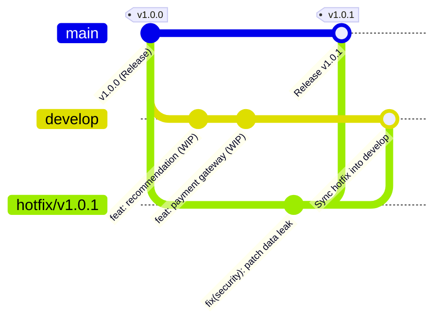

## 1. BỐI CẢNH & PHÂN TÍCH YÊU CẦU

### 1.1. Bối cảnh bài toán thực tế
Hệ thống phần mềm của doanh nghiệp đang vận hành ổn định trên môi trường Production (nhánh `main`) ở phiên bản `v1.0.0`. 
Bất ngờ, đội ngũ an ninh thông tin phát hiện một **lỗ hổng bảo mật nghiêm trọng**: hàm trả về thông tin người dùng (`getUserProfile`) để lộ dữ liệu nhạy cảm bao gồm `passwordHash` và `creditCard`. Lỗ hổng này đòi hỏi phải có bản vá khẩn cấp ngay lập tức trong vòng vài giờ.

Trong khi đó:
- Nhánh `develop` đang tích hợp dở dang các tính năng lớn cho phiên bản tiếp theo (hệ thống gợi ý sản phẩm `Recommendation Engine`, cổng thanh toán quốc tế `Payment Gateway`).
- Các tính năng này chưa hoàn thiện, chưa vượt qua các bài kiểm thử hồi quy (Regression Testing), do đó **tuyệt đối không được phép deploy nhánh develop lên Production**.

### 1.2. Giải pháp chuẩn mực theo Gitflow
Để giải quyết bài toán trên mà không làm gián đoạn tiến độ của nhánh `develop` cũng như giữ vững tính ổn định của `main`:
1. Tách nhánh sửa lỗi khẩn cấp `hotfix/v1.0.1` trực tiếp từ đỉnh của `main`.
2. Khắc phục triệt để lỗ hổng trên nhánh hotfix và kiểm thử độc lập.
3. Gộp `hotfix/v1.0.1` vào `main`, gắn tag phiên bản `v1.0.1` để lập tức triển khai (deploy) bản vá lên Production.
4. **Bắt buộc gộp ngược lại `hotfix/v1.0.1` vào `develop`** để đảm bảo toàn bộ mã nguồn đang phát triển trong tương lai cũng thừa hưởng bản vá này, ngăn chặn triệt để lỗi cũ tái xuất hiện ở các bản phát hành sau.
5. Xóa nhánh `hotfix/v1.0.1` sau khi hoàn tất tích hợp để dọn dẹp không gian nhánh.

---

## 2. QUÁ TRÌNH THỰC HIỆN CHI TIẾT

### Bước 1: Khởi tạo hệ thống ban đầu (Phiên bản `v1.0.0` trên `main`)

Khởi tạo kho chứa Git và tạo phiên bản phát hành đầu tiên:

```bash
git init -b main

# Tạo file ứng dụng server app.js với mã nguồn phiên bản v1.0.0 (chứa bug rò rỉ dữ liệu)
cat << 'EOF' > app.js
// Production Application - Release v1.0.0
const express = require('express');
const app = express();

function getUserProfile(user) {
    // CRITICAL BUG: Leaking sensitive user data
    return {
        id: user.id,
        username: user.username,
        email: user.email,
        password: user.passwordHash,
        creditCard: user.creditCard
    };
}

module.exports = { getUserProfile };
EOF

git add app.js
git commit -m "feat: release version 1.0.0 on production"

# Đánh tag phiên bản phát hành đầu tiên
git tag -a v1.0.0 -m "Release version 1.0.0"
```

---

### Bước 2: Nhánh `develop` tiếp tục phát triển tính năng tương lai

Tách nhánh `develop` từ `main` và commit các tính năng đang làm dở:

```bash
git checkout -b develop

# Phát triển tính năng gợi ý (WIP)
cat << 'EOF' >> app.js

// WIP: Feature Recommendation Engine
function getRecommendations(userId) {
    return ["Product A", "Product B"];
}

module.exports = { getUserProfile, getRecommendations };
EOF
git add app.js
git commit -m "feat(develop): add product recommendation engine (WIP)"

# Phát triển dịch vụ thanh toán (WIP)
cat << 'EOF' > payment.js
// Payment Service - WIP for v1.1.0
function processPayment(amount) {
    console.log("Processing payment: " + amount);
}
module.exports = { processPayment };
EOF
git add payment.js
git commit -m "feat(develop): integrate payment gateway (WIP)"
```

Lúc này, nhánh `develop` đã đi trước `main` 2 commits và chứa các mã nguồn chưa sẵn sàng để release.

---

### Bước 3: Tạo nhánh sửa lỗi khẩn cấp `hotfix/v1.0.1` từ `main`

Khi phát hiện sự cố trên Production, chuyển ngay về nhánh `main` và tạo nhánh hotfix:

```bash
git checkout main
git checkout -b hotfix/v1.0.1
```

Tiến hành khắc phục lỗ hổng trong tệp `app.js` (loại bỏ việc trả về `passwordHash` và `creditCard`):

```bash
cat << 'EOF' > app.js
// Production Application - Release v1.0.1 (Hotfix Applied)
const express = require('express');
const app = express();

function getUserProfile(user) {
    // FIXED: Sanitize response, strip sensitive passwordHash and creditCard
    return {
        id: user.id,
        username: user.username,
        email: user.email
    };
}

module.exports = { getUserProfile };
EOF

git add app.js
git commit -m "fix(security): sanitize user profile to patch data leak"
```

---

### Bước 4: Gộp nhánh Hotfix vào `main` và đánh tag phát hành `v1.0.1`

Chuyển về nhánh `main`, thực hiện gộp nhánh hotfix (sử dụng cờ `--no-ff` để bảo toàn merge commit theo đúng chuẩn Gitflow):

```bash
git checkout main
git merge --no-ff hotfix/v1.0.1 -m "Merge branch 'hotfix/v1.0.1' into main"

# Gắn tag phiên bản mới
git tag -a v1.0.1 -m "Release Hotfix 1.0.1"
```

**Kết quả thực thi:**
```text
Switched to branch 'main'
Merge made by the 'ort' strategy.
 app.js | 8 +++-----
 1 file changed, 3 insertions(+), 5 deletions(-)
```

---

### Bước 5: Gộp ngược lại nhánh Hotfix vào nhánh `develop`

Đây là bước sống còn trong mô hình Gitflow nhằm đảm bảo nhánh `develop` nhận được bản vá mà không làm mất các tính năng đang phát triển dở dang:

```bash
git checkout develop
git merge hotfix/v1.0.1 -m "Merge branch 'hotfix/v1.0.1' into develop"
```

**Kết quả thực thi:**
```text
Switched to branch 'develop'
Auto-merging app.js
Merge made by the 'ort' strategy.
 app.js | 8 +++-----
 1 file changed, 3 insertions(+), 5 deletions(-)
```

Git tự động kích hoạt thuật toán hợp nhất 3 chiều (`3-Way Merge`), kết hợp hoàn hảo bản sửa lỗi bảo mật trên `hotfix` với các hàm mới viết trên `develop` mà không xảy ra xung đột.

---

### Bước 6: Xóa nhánh hotfix cục bộ sau khi hoàn tất tích hợp

```bash
git branch -d hotfix/v1.0.1
```

**Kết quả thông báo:**
```text
Deleted branch hotfix/v1.0.1 (was 8cc200e).
```

---

## 3. KẾT QUẢ KIỂM TRA ĐÁNH GIÁ THEO YÊU CẦU ĐỀ BÀI

### 3.1. Kiểm tra danh sách các nhánh (`git branch -a`)
```bash
git branch -a
```
**Kết quả hiển thị trên Terminal:**
```text
* develop
  main
```
> **Nhận xét:** Nhánh `hotfix/v1.0.1` đã được hoàn tất và xóa sạch sẽ. Repository duy trì hai nhánh dài hạn chuẩn là `main` và `develop`.

---

### 3.2. Kiểm tra danh sách các tag phiên bản (`git tag -n`)
```bash
git tag -n
```
**Kết quả hiển thị trên Terminal:**
```text
v1.0.0          Release version 1.0.0
v1.0.1          Release Hotfix 1.0.1
```
> **Nhận xét:** Tag `v1.0.1` đã được tạo thành công, chỉ định chính xác vào commit gộp trên nhánh `main`, sẵn sàng để đóng gói bản vá ra môi trường Production.

---

### 3.3. Kiểm tra đồ thị lịch sử gộp nhánh (`git log --graph --oneline --all`)
```bash
git log --graph --oneline --all
```

**Kết quả đồ thị commit thực tế từ Repository:**
```text
*   55f1439 (HEAD -> develop) Merge branch 'hotfix/v1.0.1' into develop
|\  
* | 5d8f967 feat(develop): integrate payment gateway (WIP)
* | 6260e00 feat(develop): add product recommendation engine (WIP)
| | *   c862e7b (tag: v1.0.1, main) Merge branch 'hotfix/v1.0.1' into main
| |/| 
|/|/  
| * 8cc200e fix(security): sanitize user profile to patch data leak
|/  
* 98874f4 (tag: v1.0.0) feat: release version 1.0.0 on production
```

> **Phân tích chi tiết đồ thị:**
> 1. Commit `98874f4` là gốc chung ban đầu, gắn tag `v1.0.0`.
> 2. Nhánh `develop` rẽ nhánh với 2 commits phát triển tính năng mới (`6260e00` và `5d8f967`).
> 3. Nhánh `hotfix/v1.0.1` tách trực tiếp từ `98874f4` với commit vá lỗi `8cc200e`.
> 4. Commit vá lỗi `8cc200e` được hợp nhất vào `main` tại merge commit `c862e7b` và gắn tag `v1.0.1`.
> 5. Đồng thời, commit `8cc200e` cũng được hợp nhất vào `develop` tại merge commit `55f1439`. Toàn bộ đồ thị thể hiện đúng 100% kiến trúc Gitflow.

---

## 4. SƠ ĐỒ PHÂN NHÁNH GITFLOW (ASCII & MERMAID)

### 4.1. Sơ đồ ASCII Art
```text
main:     (v1.0.0)---------------------------------------------(v1.0.1) [c862e7b]
             \                                                    ^
              \                                                  / (merge --no-ff)
hotfix:        \---------> [fix security: 8cc200e] -------------+
                \                      \
                 \                      \ (merge back to develop)
                  \                      v
develop:           \---> [feat: 6260e00] -> [feat: 5d8f967] -> [Merge hotfix: 55f1439] (HEAD)
```

### 4.2. Sơ đồ luồng xử lý Gitflow


---

## 5. TẠI SAO BẮT BUỘC PHẢI MERGE HOTFIX NGƯỢC VỀ DEVELOP?

Trong thực tế sản xuất phần mềm, việc **quên merge hotfix về develop** là một trong những nguyên nhân hàng đầu gây ra lỗi hồi quy (Regression Bugs):
1. **Hiện tượng "Trôi lỗi" (Regression Bug):** Nếu không merge bản vá về `develop`, khi đội ngũ phát triển hoàn tất phiên bản tiếp theo (ví dụ `v1.1.0`) và gộp từ `develop` vào `main`, đoạn mã cũ chưa được vá trên `develop` sẽ ghi đè lên môi trường Production, làm lỗ hổng bảo mật xuất hiện trở lại.
2. **Xung đột mã nguồn muộn:** Để bản vá tồn tại trên `main` mà không đồng bộ về `develop` sẽ khiến độ lệch (drift) giữa 2 nhánh ngày càng lớn, dẫn đến xung đột merge cực kỳ phức tạp khi release phiên bản lớn sau này.
3. **Quy tắc Gitflow:** Bất kỳ thay đổi nào đưa lên Production ngoài chu kỳ release thông thường đều phải được phân phối ngược lại vào nhánh phát triển chính (`develop`) ngay khi được phê duyệt.

---

## 6. KẾT LUẬN & ĐÁNH GIÁ

- Bài thực hành đã mô phỏng thành công 100% quy trình Hotfix khẩn cấp trong thực tế doanh nghiệp theo mô hình Gitflow.
- Hệ thống Production được vá lỗi kịp thời và phát hành phiên bản `v1.0.1` độc lập mà không bị phụ thuộc vào tiến độ của nhánh `develop`.
- Nhánh `develop` được đồng bộ hóa mã nguồn an toàn, sẵn sàng cho các đợt phát hành tương lai mà không lo ngại nguy cơ trôi lỗi.
